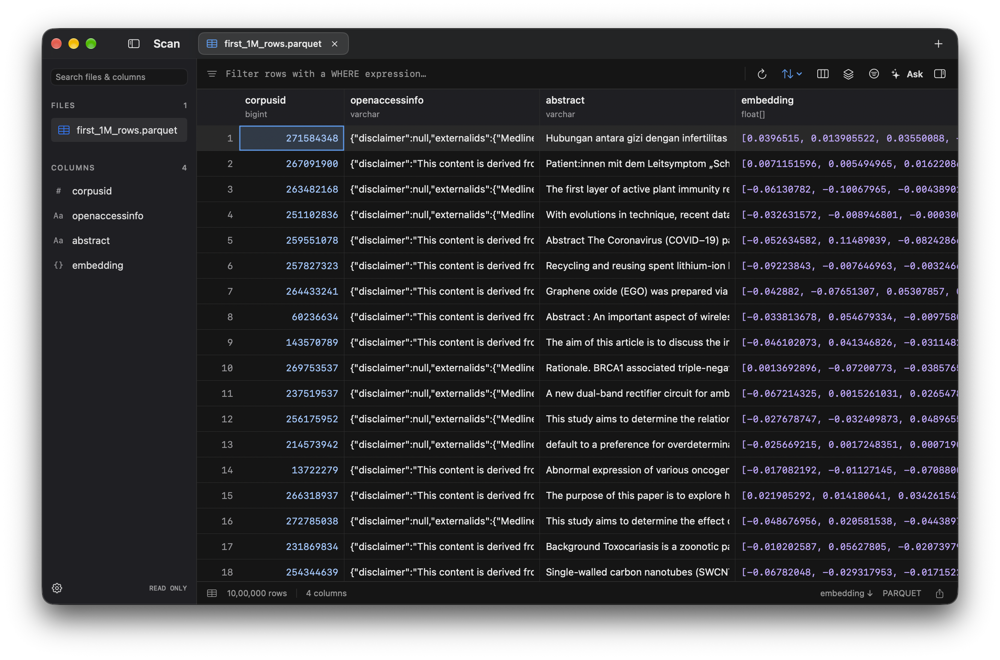

<p align="center">
  
</p>

<h1 align="center">Scan</h1>

<p align="center">A fast, native, read-only macOS viewer for Parquet, CSV, TSV, JSON, JSONL/NDJSON, GeoJSON, Excel, SQLite and DuckDB files.</p>

<p align="center">
  
</p>

Scan opens these files:

| Format | Extensions |
|---|---|
| Delimited text | `.csv`, `.tsv`, `.tab`, `.psv` (pipe), `.txt` and `.dat` (delimiter detected) |
| JSON | `.json` (an array of objects, one object per line, or a single object), `.jsonl`, `.ndjson` |
| GeoJSON | `.geojson`: one row per feature, properties as columns, geometry as JSON |
| Compressed text | any of the above with `.gz` or `.zst`/`.zstd`, such as `.csv.zst` or `.jsonl.gz` |
| Parquet | `.parquet`, `.parq`, `.pq` |
| Excel | `.xlsx`: each sheet is listed as a table |
| Databases | SQLite (`.sqlite`, `.sqlite3`, `.db`, `.db3`, `.s3db`, `.sl3`) and DuckDB (`.duckdb`, `.ddb`). A database is identified by its header, so a `.db` file can be either. |
| Folders | a folder of Parquet, CSV/TSV or JSON Lines files opens as one table, matched recursively. Files with different columns are combined by name, and Hive-partitioned folders such as `year=2024/` become columns. |

It can also preview remote Parquet files from HTTPS URLs, such as Hugging Face datasets, and from Amazon S3, Google Cloud Storage and Cloudflare R2, without downloading the whole file, and open other remote files by downloading them. In JSON and JSONL files, fields become columns with automatically inferred types, and the inspector shows JSON cells as a tree you can expand.

Excel column types come from each sheet's first data row. If a later cell does not match, the sheet is read with every column as text so that no value is lost. Rows below blank rows are kept. Legacy `.xls` files are not supported. It uses DuckDB for queries and a custom AppKit grid for large files, so a 4 GB Parquet file paints its first rows in well under half a second. Files are never modified.

- **Filter, sort and group** with DuckDB `WHERE` expressions, multi-column sorts and group-bys.
- **Click a value to filter**: right-click a cell for Only, Exclude, Greater Than, Less Than, Contains or Exclude NULL. Each choice is added to the current filter with AND.
- **Column profiles**: the inspector's Profile tab shows a column's row, NULL and distinct counts, its min, max and mean, a histogram, and its most common values. Click a bar or a value to filter to it. Numeric headers show a small distribution chart, and the arrow beside each column in the sidebar lists its top values.
- **Heatmaps** color a numeric column from green at its minimum to red at its maximum.
- **Saved views**: each file remembers its filter, sorts, hidden and reordered columns, column widths and heatmaps. **Reset View** (the curved arrow in the toolbar) forgets them.
- **Quick Look**: press space on a file in Finder to see its first 10 rows.
- **Ask**: type a question and Scan turns it plus the file's schema into a read-only DuckDB query. It uses Apple's on-device Foundation Models framework, so it needs macOS 26 or later with Apple Intelligence available.
- **Export** the current filtered and sorted view as a new CSV, JSON, JSON Lines or Parquet file.
- **Light and dark** appearance, or follow the system, from **Settings → Appearance**.
- **CLI**: `scan file.parquet` opens a file from the terminal, `scan path/to/folder` opens a folder of files as one table, and `scan https://…/file.parquet` or `scan s3://bucket/key.parquet` opens a remote one.

## Remote files

Open a Parquet file directly from HTTPS without downloading it first with **File → Open URL…** (⇧⌘O), or from the CLI:

```sh
dist/bin/scan 'https://huggingface.co/datasets/org/name/resolve/main/file.parquet'
```

Hugging Face `/blob/` links are rewritten to `/resolve/` automatically. Scan reads the Parquet footer and only the row groups needed to paint the visible pages, using HTTP range requests. Downloaded ranges are kept in a sparse cache file at `~/Library/Caches/dev.scan.app/RemoteParquet`, which is capped at 5 GB and evicts the least recently used files first. Reopening a remote file therefore fetches only what is still missing. To open gated or private repositories, save a token in **Settings → Hugging Face** (kept in the login keychain), or set `HF_TOKEN` (or `HUGGING_FACE_HUB_TOKEN` / `HUGGINGFACE_TOKEN`) when launching Scan from a terminal.

Actions that need every row — applying a filter, sorting, grouping, exporting, or Ask — download the remaining row groups first. The status bar shows how much of the remote file is cached. For Parquet, the server must support HTTP range requests.

Other remote files, such as CSV, JSON Lines or Excel, are downloaded in full into the same cache each time they are opened, then read like local files. Remote files are not watched for changes.

### Cloud storage

`s3://bucket/key`, `gs://bucket/key` and `r2://bucket/key` URLs work wherever an HTTPS URL does, through the same range reader and cache. Requests are signed with AWS Signature Version 4. Public buckets need no keys. For private ones, add keys in **Settings → Cloud Storage** (kept in the login keychain), or set environment variables, which take precedence:

| Provider | Variables | Notes |
| --- | --- | --- |
| Amazon S3 | `AWS_ACCESS_KEY_ID`, `AWS_SECRET_ACCESS_KEY`, optional `AWS_SESSION_TOKEN`, `AWS_REGION`, `AWS_ENDPOINT_URL` | The bucket's region is found automatically. An endpoint points Scan at an S3-compatible server such as MinIO. |
| Google Cloud Storage | `GCS_ACCESS_KEY_ID`, `GCS_SECRET_ACCESS_KEY` | HMAC keys from Cloud Storage → Settings → Interoperability. |
| Cloudflare R2 | `R2_ACCOUNT_ID`, `R2_ACCESS_KEY_ID`, `R2_SECRET_ACCESS_KEY` | Keys from an R2 API token with read access. |

Scan does not read `~/.aws/credentials`.

## Download and install

Download [Scan v1.3.0 for Apple Silicon Macs](https://github.com/anudit/scan/releases/tag/v1.3.0). Requires macOS 14 or later. Intel Macs are not supported by this release.

Open the `.dmg` and drag **Scan.app** to **Applications**, or extract the `.zip` and move **Scan.app** there. The ZIP also includes the optional `bin/scan` command, which you can copy to a directory on your `PATH` after installing the app.

This release is ad hoc signed and is not notarized. If macOS blocks the first launch, open **System Settings → Privacy & Security → Open Anyway** after trying to open Scan, then confirm. See [Apple's instructions](https://support.apple.com/en-us/102445).

Use **File → Open…**, drop a supported file or folder onto Scan, or choose **Open With → Scan** in Finder. Set it as the default viewer with **Get Info → Open with → Scan → Change All…**. The Ask feature additionally requires macOS 26 or later with Apple Intelligence available.

## Build

Requires an Apple Silicon Mac running macOS 14 or later, Xcode with the macOS SDK, Python 3, CMake and Ninja. Install the additional build tools with `brew install cmake ninja` if needed.

```sh
scripts/build.sh
open dist/Scan.app
dist/bin/scan /path/to/file.parquet
```

On first use the build downloads DuckDB 1.5.6 archives and matching source, and checks their SHA-256 hashes. It builds a tailored library containing JSON, Parquet, Excel, core SQL functions and ICU, with autocomplete omitted. The Parquet extension is compiled from source with `scripts/patches/duckdb-parquet-page-seek.patch`, which lets deep row jumps seek past whole pages instead of decoding them. The Excel extension is fetched at the commit DuckDB 1.5.6 pins and compiled from source against a static build of minizip-ng 4.0.7 (checksum-verified) and the system's expat and zlib, which adds about 0.4 MiB. The app bundle includes the Quick Look preview extension, and `scripts/build.sh` registers it with Launch Services.

Create downloadable release archives after building with `scripts/package-release.sh`. The v1.3.0 app occupies approximately 51 MiB on disk; the archives are compressed.

Run the engine and query tests with:

```sh
swift test --disable-sandbox --build-system native
```

To exercise the remote reader against a real server, set `SCAN_REMOTE_URL` to a public Parquet URL:

```sh
SCAN_REMOTE_URL='https://huggingface.co/…/file.parquet' swift test --disable-sandbox --build-system native --filter testLiveRemoteURL
```

## Benchmarks: Scan versus Tad 0.14

These are medians of three runs on the same M2 Max, 64 GB Mac running macOS 27.0. Memory is the total process-tree physical footprint reported by `top`. The [raw Scan runs](bench/results/scan-v0.1/) and [Tad runs](bench/results/) are saved as JSON.

| Test | Tad | Scan |
|---|---:|---:|
| App bundle on disk | 677 MB | 49 MB |
| 4 GB Parquet: first painted rows | ~2–3 s, estimated | 0.367 s |
| 4 GB Parquet: CPU quiescence | 5.4 s | 2.2 s |
| 4 GB Parquet: peak / idle memory | 699 / 562 MB | 99 / 95 MB |
| 4 GB Parquet: idle CPU | 0.9% | 0.27% |
| Small CSV: CPU quiescence | 4.3 s | 2.2 s |
| Small CSV: peak / idle memory | 372 / 311 MB | 87 / 84 MB |
| Scroll stress: mean / peak CPU | 67 / 107% | 12.8 / 53.9% |
| Scroll stress: CPU time | 7.4 CPU-s | 1.66 CPU-s |
| Scroll stress: peak / later idle memory | 875 / 589 MB | 151 / 139 MB |
| Process count | 4 | 1 |

## License

Scan is released under the [MIT License](LICENSE). It bundles [DuckDB](https://duckdb.org), which is also [MIT-licensed](https://github.com/duckdb/duckdb/blob/v1.5.6/LICENSE). The app includes a copy at `Contents/Resources/DuckDB-LICENSE`, along with the licenses of the DuckDB Excel extension (MIT) and minizip-ng (zlib) in the same folder.
